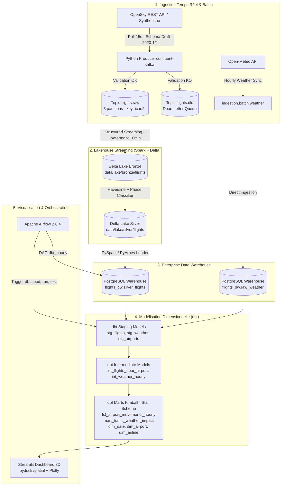

# 🇲🇦 Moroccan Air Traffic Streaming Platform (Enterprise Edition)


Plateforme moderne de streaming et d'ingénierie analytique pour la surveillance temps réel et l'analyse historique de l'espace aérien marocain (Casablanca CMN, Marrakech RAK, Rabat RBA, Agadir AGA, Tanger TNG). 
Le système corrèle le trafic avec les conditions météorologiques (Open-Meteo), les cycles calendaires (Ramadan, Aïd) et les méga-événements futurs (CAN 2025, Mondial FIFA 2030).

---

## 🎯 Problématique & Objectif Métier

Comment le trafic aérien au-dessus du Maroc varie-t-il selon :
- **La météo et les conditions critiques** (rafales > 50 km/h, visibilité < 2 km, précipitations) ?
- **Les cycles religieux et vacances** (Ramadan, Aïd al-Fitr, chassés-croisés des MRE) ?
- **Les méga-événements sportifs et économiques** (CAN 2025, Coupe du Monde FIFA 2030) ?

> ⚠️ **Rigueur méthodologique :** L'API OpenSky Network ne fournit pas d'horaires de vol théoriques. Aucun retard artificiel n'est injecté : la plateforme calcule des **proxies opérationnels d'ingénierie aéronautique** (densité horaire d'aéronefs distincts, phases de vol dérivées par heuristiques géodésiques, écarts par rapport aux médianes de trafic observées).

---

## 🏛️ Architecture du Système



---

## 🛠️ Stack Technologique & Rôles

| Composant | Version | Rôle Opérationnel | Justification Entreprise |
| :--- | :--- | :--- | :--- |
| **Apache Kafka** | `3.6` (Confluent 7.6.1) | Message Broker distribué | Standard mondial d'ingestion streaming ; persistance avec rétention configurable et scalabilité horizontale. |
| **Apache ZooKeeper** | `3.8` (Confluent 7.6.1) | Coordination de cluster | Gestion de consensus, élection de contrôleur et métadonnées de partitionnement. |
| **Apache Spark** | `3.5.1` (Python 3.11) | Moteur de traitement streaming | Structured Streaming tolérant aux pannes, déduplication temporelle (`watermark 10 min`). |
| **Delta Lake** | `3.1.0` | Format de stockage Lakehouse | Transactions ACID, time travel et schéma enforcement au niveau fichier. |
| **PostgreSQL DW** | `15` | Data Warehouse relationnel | Entrepôt dédié (`flights_dw`) pour servir les outils analytiques et requêtes dbt avec isolation stricte. |
| **dbt Core** | `1.8.10` | Transformation & Tests de données | Modélisation dimensionnelle (Kimball), tests de contrainte automatisés (49 tests), multi-target Postgres/Snowflake. |
| **Apache Airflow** | `2.8.4` | Orchestration de pipelines batch | Gestion des dépendances, reprises sur incident et automatisation horaire `silver_to_warehouse >> dbt run >> dbt test`. |
| **Streamlit + pydeck** | `1.32+` | BI & Visualisation Géospatiale | Tableau de bord temps réel avec projection 3D des trajectoires et corrélation météo-trafic. |
| **Pytest & Ruff** | `pytest 9.1`, `ruff` | Assurance Qualité & Intégrité | 78 tests unitaires/intégration, linting strict PEP-8 et validation contractuelle JSON Schema. |

---

## 🌐 Cartographie des Services & Interfaces Web

Lorsque la stack est active, tous les services sont exposés sur des ports isolés :

| Interface / Service | URL / Port Local | Identifiants | Rôle |
| :--- | :--- | :--- | :--- |
| **Streamlit Dashboard** | [http://localhost:8501](http://localhost:8501) | *Accès libre* | Carte 3D pydeck, métriques de trafic et impact météo |
| **Kafka UI** | [http://localhost:8080](http://localhost:8080) | *Accès libre* | Monitoring des topics (`flights.raw`, `flights.dlq`), des partitions et des offsets |
| **Airflow Webserver** | [http://localhost:8085](http://localhost:8085) | `airflow` / `airflow` | Supervision des DAGs (`dbt_hourly`, `weather_daily`) |
| **PostgreSQL Data Warehouse** | `localhost:5433` | `flights_user` / `flights_password_dev` | Base `flights_dw`, hébergeant les couches staging, intermediate et marts |
| **Kafka Broker Direct** | `localhost:9092` / `localhost:19092` | *Sans auth (dev)* | Accès programmatique direct aux streams Kafka |

---

## 🚀 Guide de Démarrage Rapide

### Prérequis
- Docker et Docker Compose (Docker Desktop avec support Linux Containers)
- Python 3.11+
- 6 Go de RAM alloués à Docker

### 1. Variables d'Environnement
```bash
cp .env.example .env
```
*(Par défaut, `PRODUCER_SYNTHETIC_MODE=true` permet de démarrer l'infrastructure complète sans clé API ni dépendance réseau externe).*

### 2. Démarrage de la Stack
```bash
docker compose up -d --build
```
Vérifier l'état de santé des conteneurs :
```bash
docker compose ps
```

### 3. Exécution manuelle de la synchronisation DW et des modèles dbt
```bash
# Chargement incrémental Silver -> PostgreSQL DW
docker compose exec airflow-webserver python -m ingestion.batch.silver_to_postgres

# Exécution des modèles dbt et de leurs tests d'intégrité
docker compose exec airflow-webserver dbt seed --project-dir /opt/airflow/dbt_project --profiles-dir /opt/airflow/dbt_project
docker compose exec airflow-webserver dbt run --project-dir /opt/airflow/dbt_project --profiles-dir /opt/airflow/dbt_project
docker compose exec airflow-webserver dbt test --project-dir /opt/airflow/dbt_project --profiles-dir /opt/airflow/dbt_project
```

### 4. Lancement de la Suite de Tests Unitaires
```bash
python -m pytest tests/
```
Résultat attendu : `78 passed in 0.96s`.

---

## 📐 Modélisation Dimensionnelle (dbt Kimball Star Schema)

L'entrepôt `flights_dw` est organisé en couches standardisées :

```text
flights_dw (PostgreSQL DW / Snowflake)
├── public (Tables brutes chargées depuis Delta Lake & Open-Meteo)
│   ├── silver_flights
│   └── raw_weather
│
├── public_staging (Nettoyage, typage strict numeric/timestamps, normalisation)
│   ├── stg_flights
│   ├── stg_weather
│   ├── stg_airports (Seed ICAO/IATA des 5 aéroports marocains majeurs)
│   └── stg_airlines (Seed des compagnies aériennes)
│
├── public_intermediate (Calculs géodésiques et agrégats horaires)
│   ├── int_flights_near_airport (Distances Haversine < 50 km)
│   ├── int_flight_phases (Classification montée, croisière, descente, sol)
│   └── int_weather_hourly (Météo normalisée par tranche horaire)
│
└── public_marts (Tables de faits et dimensions Kimball optimisées pour la BI)
    ├── dim_airport (Coordonnées, ICAO, ville, piste principale)
    ├── dim_date (Calendrier enrichi : jour, mois, trimestre, indicateurs Ramadan/Aïd)
    ├── dim_airline (Dimension compagnie enrichie avec snapshot SCD Type 2)
    ├── fct_airport_movements_hourly (Mouvements horaires par aéroport)
    ├── fct_traffic_density (Densité d'aéronefs par tranche d'altitude)
    └── mart_traffic_weather_impact (Corrélation finale trafic vs vent/visibilité)
```

### Portabilité Multi-Cibles (PostgreSQL & Snowflake)
Tous les modèles SQL sont conçus pour être compatibles à la fois avec **PostgreSQL** (moteur local de développement et de CI) et **Snowflake** (cible cloud d'entreprise) :
- Les fonctions de date utilisent `EXTRACT(DOW FROM ...)` et `TO_CHAR(...)` supportées nativement par les deux moteurs.
- Les arrondis spatiaux utilisent `ROUND(CAST(val AS numeric), 4)` évitant les ambiguïtés de type `double precision`.
- Les cibles de profils sont paramétrées dans `dbt_project/profiles.yml` avec sélection transparente via `dbt run --target dev` ou `dbt run --target snowflake`.

---

## 🎯 Préparation aux Entretiens Techniques (Data Engineering Q&A)

Voici les réponses aux questions clés d'architecture susceptibles d'être posées lors de la soutenance du projet :

#### Q1 : Pourquoi avoir choisi Apache Kafka avec ZooKeeper plutôt qu'une solution embarquée ?
> **Réponse :** "Pour un projet d'envergure professionnelle, Apache Kafka 3.6 avec ZooKeeper représente le standard de référence déployé en entreprise. Il garantit une gestion fine du partitionnement (`flights.raw` partitionné par clé `icao24`), une scalabilité horizontale éprouvée, et permet de simuler un environnement de production fidèle aux exigences des grands comptes aéronautiques et logistiques."

#### Q2 : Pourquoi conserver Delta Lake pour le streaming et PostgreSQL pour le Data Warehouse ?
> **Réponse :** "C'est l'application du pattern Lakehouse : Apache Spark Structured Streaming gère l'ingestion à très haute fréquence et écrit en continu dans Delta Lake (Bronze/Silver) avec support des transactions ACID et du watermarking temporel. PostgreSQL (et Snowflake en production) agit comme l'entrepôt analytique (Gold Layer), optimisé pour les requêtes complexes de dbt, les index relationnels et l'interrogation par le tableau de bord Streamlit."

#### Q3 : Comment gérez-vous l'idempotence et les doublons de vol ?
> **Réponse :** "Le producteur Kafka publie chaque événement avec comme clé de partitionnement l'indicatif unique de l'aéronef (`icao24`). Spark applique ensuite un `dropDuplicates(['icao24', 'timestamp'])` associé à un `withWatermark('timestamp', '10 minutes')`. Cela permet d'absorber les messages arrivés en retard tout en garantissant un traitement sémantique Exactly-Once dans la couche Silver."

#### Q4 : Comment la qualité des données est-elle garantie de bout en bout ?
> **Réponse :** "La qualité s'opère à trois niveaux : (1) Validation stricte du schéma JSON Draft 2020-12 à l'ingestion avec redirection immédiate vers une Dead Letter Queue (`flights.dlq`) en cas d'anomalie ; (2) 78 tests unitaires automatisés validant les calculs Haversine, les fonctions Spark et les DAGs Airflow ; (3) 49 tests de contrainte dbt (unicité, non-nullité, clés étrangères et tests personnalisés d'intégrité sur les mouvements d'aéroports)."

---

## 🔮 Pistes d'Évolution

1. **Modèle de Machine Learning Prédictif** : Entraîner un modèle XGBoost ou Prophet sur `mart_traffic_weather_impact` pour anticiper les congestions d'aéroports 24 heures à l'avance en fonction des prévisions météo.
2. **Monitoring & Alerting Datadog / Prometheus** : Exposer les métriques JMX de Kafka et Spark pour déclencher des alertes automatiques sur le lag des consommateurs.
3. **Migration Iceberg** : Tester l'écriture conjointe Apache Iceberg / Delta Lake pour valider l'interopérabilité des tables ouvertes.
