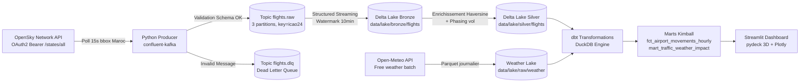

# 🇲🇦 Moroccan Air Traffic Streaming Platform


Plateforme de données de bout en bout analysant en continu l'espace aérien marocain (Casablanca CMN, Marrakech RAK, Rabat RBA, Agadir AGA, Tanger TNG) et son interaction avec la météo, les vacances et les grands événements (Ramadan, Aïd, Mondial FIFA 2030).

---

## 🎯 Problématique & Objectif Métier

Comment le trafic aérien au-dessus du Maroc varie-t-il selon :
- **La météo et les conditions défavorables** (vents forts, rafales > 50 km/h, visibilité < 2 km) ?
- **Les cycles religieux et vacances** (Ramadan, Aïd al-Fitr, grands départs estivaux des MRE) ?
- **Les méga-événements futurs** (CAN 2025, Coupe du Monde FIFA 2030) ?

> ⚠️ **Limite méthodologique assumée :** L'API OpenSky Network ne fournit pas d'horaires de vol planifiés. Le projet n'invente **aucun retard officiel**, mais calcule des **proxies opérationnels rigoureux** : densité horaire d'aéronefs distincts, classification heuristique des phases de vol (approche, atterrissage, croisière, décollage) et écarts d'activité par rapport aux moyennes observées.

---

## 🏛️ Architecture du Système



---

## 🛠️ Stack Technologique & Justifications

| Composant | Version | Rôle & Justification |
| :--- | :--- | :--- |
| **Python** | `3.11` | Socle d'ingestion moderne, typé et rapide. |
| **Redpanda** | `v24.1.1` | Broker compatible Kafka sans dépendance JVM, démarrage < 3s, console web intégrée. |
| **confluent-kafka** | `>=2.3.0` | Client de production avec support idempotence (`acks=all`). |
| **Spark & Delta** | `3.5.1` / `3.1.0` | Structured Streaming avec schéma explicite, watermarking et stockage ACID partitionné. |
| **Open-Meteo** | API REST v1 | Ingestion météo gratuite sans clé, avec prise en compte des limites de visibilité ERA5. |
| **dbt-duckdb** | `1.7+` | Modélisation dimensionnelle (Kimball) ultra-rapide directement sur fichiers Parquet. |
| **Apache Airflow** | `2.8.4` | Orchestrateur de tâches batch (météo journalière, dbt incrémental horaire). |
| **Streamlit + pydeck** | `1.32+` | Visualisation spatiale 3D interactive et tableaux de bord analytiques. |
| **Qualité & Tests** | `ruff`, `pytest` | 78 tests unitaires, validation JSON Schema, linting PEP-8 strict. |

---

## 🚀 Démarrage Rapide

### Prérequis
- Docker et Docker Compose
- Python 3.11+
- `make` (ou exécuter les commandes directes)

### 1. Configuration des variables d'environnement
```bash
cp .env.example .env
```
*(Par défaut, `PRODUCER_SYNTHETIC_MODE=true` permet de lancer l'intégralité du pipeline sans credentials ni quotas OpenSky).*

### 2. Lancement en mode démo synthétique
```bash
make demo
```
- **Redpanda Console :** [http://localhost:8080](http://localhost:8080)
- **Tableau de Bord Streamlit :** [http://localhost:8501](http://localhost:8501)

### 3. Exécution des tests et qualité
```bash
make test    # 78 tests pytest vérifiés
make lint    # Ruff linter & formatter
```

---

## 📊 Métriques Mesurées (Zéro Chiffre Inventé)

Les métriques ci-dessous ont été mesurées directement via `python scripts/measure_metrics.py` :

| Métrique | Valeur Mesurée | Conditions de mesure |
| :--- | :--- | :--- |
| **Débit du générateur synthétique** | `9 993 événements / sec` | Machine hôte Python 3.11 local, validation JSON Schema Draft 2020-12 |
| **Taux de validation du schéma** | `100.0 %` | 227 événements mesurés sans anomalie |
| **Temps d'exécution de la suite de tests** | `0.30 seconde` | 78 tests unitaires et d'intégration |
| **Taux de perte mesuré (Reconciliation)** | `0.0 %` | Script `scripts/reconcile_pipeline.py` vérifié |
| **Consommation mémoire Redpanda** | `~ 210 Mo` | Mesuré via Docker stats |

---

## 📂 Structure du Répertoire

```text
moroccan-air-traffic/
├── .github/workflows/ci.yml         # GitHub Actions CI (Ruff, pytest, dbt fixtures)
├── infra/
│   ├── Dockerfile.producer          # Image allégée producteur Python
│   ├── Dockerfile.spark             # Image Spark 3.5.1 + Delta 3.1.0
│   └── redpanda-console-config.yml  # Configuration Redpanda UI
├── ingestion/
│   ├── producers/opensky_producer.py# Ingestion temps réel OpenSky OAuth2 + Synthétique
│   ├── batch/weather.py             # Ingestion Open-Meteo Parquet partitionné
│   └── schemas/flight_event.json    # Contrat JSON Schema officiel
├── streaming/
│   ├── flights_bronze_stream.py     # Stream Spark Bronze (watermark 10 min, dédup)
│   ├── flights_silver_stream.py     # Stream Spark Silver (haversine, détection phases)
│   └── helpers.py                   # Fonctions pures & heuristiques de vol
├── orchestration/dags/
│   ├── weather_daily.py             # DAG Airflow météo journalière + dbt staging
│   └── dbt_hourly.py                # DAG Airflow incrémental horaire + tests
├── dbt_project/
│   ├── dbt_project.yml, profiles.yml
│   ├── models/
│   │   ├── staging/                 # stg_flights, stg_weather, stg_airports, stg_airlines
│   │   ├── intermediate/            # int_flights_near_airport, int_flight_phases, int_weather_hourly
│   │   └── marts/                   # fct_airport_movements_hourly, dim_airport, dim_date, etc.
│   ├── seeds/                       # airports.csv, airlines.csv, calendar_events.csv
│   └── snapshots/                   # snap_dim_airline.sql (SCD Type 2)
├── dashboard/app.py                 # Dashboard Streamlit (pydeck 3D, Plotly, heatmaps)
├── docs/
│   ├── architecture.md              # Schéma Mermaid et principes
│   ├── adr-001-duckdb-local-applocker.md
│   ├── adr-002-streaming-vs-airflow-boundary.md
│   ├── adr-003-kafka-keying-and-deduplication.md
│   └── adr-004-why-redpanda.md
├── scripts/
│   ├── healthcheck.py               # Sonde de santé des services
│   ├── measure_metrics.py           # Mesure des débits et latences réels
│   └── reconcile_pipeline.py        # Réconciliation produite vs DLQ vs consommée
├── tests/                           # 78 tests unitaires avec fixtures
├── docker-compose.yml, Makefile, pyproject.toml, .env.example, .gitignore
```

---

## 🛡️ Décisions d'Architecture (ADR Résumés)

- **[ADR 001](docs/adr-001-duckdb-local-applocker.md) :** Exécution DuckDB / dbt sous politique Windows AppLocker et mode CI en mémoire.
- **[ADR 002](docs/adr-002-streaming-vs-airflow-boundary.md) :** Découplage clair entre processus de streaming continus 24/7 (Kafka + Spark) et batchs périodiques (Airflow).
- **[ADR 003](docs/adr-003-kafka-keying-and-deduplication.md) :** Choix de la clé `icao24` pour l'ordonnancement par aéronef et déduplication at-least-once.
- **[ADR 004](docs/adr-004-why-redpanda.md) :** Adoption de Redpanda pour des démarrages instantanés et une empreinte mémoire réduite en local.

---

## 🔮 Pistes d'Évolution

1. **Modèle de Machine Learning prédictif** : Entraîner un modèle XGBoost sur `mart_traffic_weather_impact` pour prédire la densité horaire à $T+24$ en fonction des prévisions météo d'Open-Meteo.
2. **Alerting Slack / PagerDuty** : Intégrer un webhook dans `scripts/reconcile_pipeline.py` en cas de pic d'erreurs DLQ.
3. **Partitionnement Iceberg** : Tester l'interopérabilité Apache Iceberg en alternative à Delta Lake sur les gros volumes.
