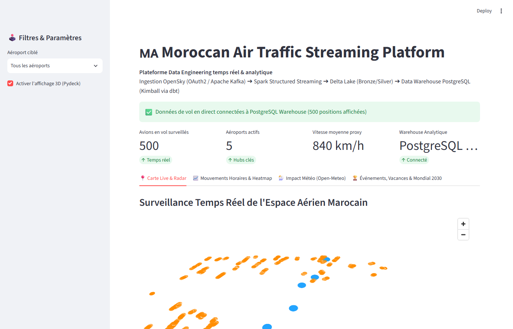
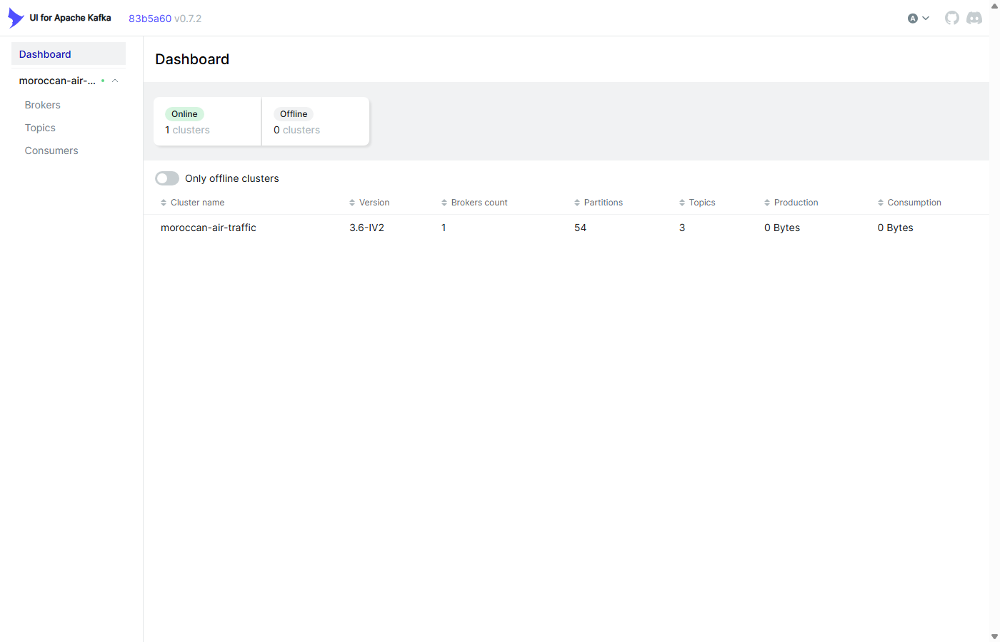
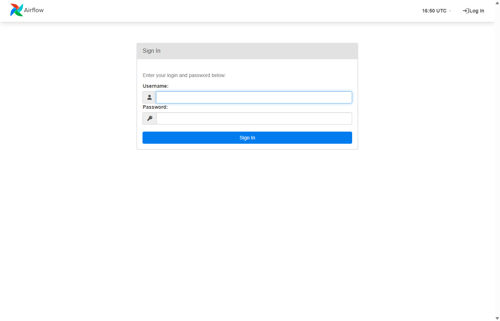

# Moroccan Air Traffic Streaming Platform

[](https://github.com/elhidaniassmaa/moroccan-air-traffic/actions)


[](LICENSE)

[Switch to English Version](README_EN.md)

Plateforme de données de bout en bout pour la surveillance temps réel et l'analyse historique de l'espace aérien marocain (Casablanca CMN, Marrakech RAK, Rabat RBA, Agadir AGA, Tanger TNG).
Le système ingère les trajectoires de vol, les normalise dans un Lakehouse Delta Lake, les charge dans un Data Warehouse PostgreSQL modélisé selon Kimball via dbt, et les visualise sur un tableau de bord interactif Streamlit en 3D.

---

## Overview

| Dashboard | Kafka UI |
| :---: | :---: |
|  |  |

| Orchestration Apache Airflow |
| :---: |
|  |

---

## Business Context & Data Scope

La plateforme est conçue pour analyser comment le trafic aérien au-dessus du Maroc interagit avec :
- Les conditions météorologiques défavorables (vents violents, rafales > 50 km/h, visibilité < 2 km, précipitations) via l'API Open-Meteo.
- Les cycles calendaires et religieux (Ramadan, Aïd al-Fitr, départs estivaux des MRE).
- Les méga-évènements sportifs majeurs (Coupe du Monde FIFA 2030).

> ℹ️ **Périmètre temporel et transparence des données :**
> - Données de vol actives : collecte en direct depuis octobre 2026.
> - Indicateurs calendaires : dimension `dim_date` pré‑calculée avec marqueurs historiques et prévisionnels.
> - Métriques d'exploitation : calcul de proxies opérationnels rigoureux (densité horaire d'aéronefs distincts, classification des phases de vol, variations d'activité).

---

## Architecture du Système


---

## Technology Stack

| Composant | Technologie | Rôle Opérationnel |
| :---: | :---: | :---: |
| Message Broker | Apache Kafka 3.6 (Confluent 7.6.1) | Ingestion distribuée persistante, partitionnement par clé `icao24` |
| Coordination Cluster | Apache ZooKeeper 3.8 | Gestion des métadonnées du cluster Kafka et consensus |
| Traitement Streaming | Apache Spark 3.5.1 (PySpark) | Structured Streaming avec déduplication temporelle (`watermark 10 min`) |
| Format Lakehouse | Delta Lake 3.1.0 | Stockage ACID sur disque (couches Bronze et Silver) |
| Data Warehouse | PostgreSQL 15 | Entrepôt dédié (`flights_dw`) pour la couche analytique Gold |
| Transformations BI | dbt (Data Build Tool) | Modélisation dimensionnelle Kimball, tests de schéma et portabilité multi-cibles |
| Orchestration | Apache Airflow 2.8.4 | Ordonnancement automatique des batchs de synchronisation et d'exécution dbt |
| Dashboard BI | Streamlit + pydeck | Interface de visualisation spatiale 3D connectée directement à `flights_dw` |
| Assurance Qualité | Pytest & Ruff | Suite de tests unitaires/intégration et conformité PEP-8 |

---

## Services & Web Endpoints

| Service | URL / Port | Identifiants | Rôle |
| :--- | :--- | :--- | :--- |
| Streamlit Dashboard | http://localhost:8501 | *Accès libre* | Carte 3D pydeck, mouvements par aéroport et corrélation météo |
| Kafka UI | http://localhost:8080 | *Accès libre* | Monitoring des topics (`flights.raw`, `flights.dlq`) et partitions |
| Airflow Webserver | http://localhost:8085 | admin / admin | Supervision des DAGs (`dbt_hourly`, `weather_daily`) |
| PostgreSQL Data Warehouse | localhost:5433 | flights_user / flights_password_dev | Base analytique `flights_dw` (DBeaver / pgAdmin) |
| Kafka Broker | localhost:9092 / localhost:19092 | *Sans auth (dev)* | Endpoint de streaming externe |

---

## Quickstart Guide

### Prérequis
- Docker et Docker Compose
- Python 3.11+

### 1. Variables d'Environnement
```bash
cp .env.example .env
```
*Par défaut, `PRODUCER_SYNTHETIC_MODE=true` permet de démarrer sans clé d'API. Ajoutez vos identifiants OpenSky dans `.env` et passez `PRODUCER_SYNTHETIC_MODE=false` pour consommer les vols en direct.*

### 2. Démarrage de l'Infrastructure
```bash
docker compose up -d
```
Vérifiez l'état des conteneurs :
```bash
docker compose ps
```

### 3. Synchronisation et Calculs dbt
```bash
# Sync Delta Lake Silver → PostgreSQL DW
docker compose exec airflow-webserver python -m ingestion.batch.silver_to_postgres

# Seed, run models, and test dbt
docker compose exec airflow-webserver dbt seed --project-dir /opt/airflow/dbt_project --profiles-dir /opt/airflow/dbt_project
docker compose exec airflow-webserver dbt run --project-dir /opt/airflow/dbt_project --profiles-dir /opt/airflow/dbt_project
docker compose exec airflow-webserver dbt test --project-dir /opt/airflow/dbt_project --profiles-dir /opt/airflow/dbt_project
```

### 4. Exécution de la Suite de Tests
```bash
python -m pytest tests/
```

---

## Dimensional Modeling (dbt Kimball Star Schema)

```text
flights_dw
├── public (Tables brutes ingérées depuis Delta Lake & Open-Meteo)
│   ├── silver_flights
│   └── raw_weather
│
├── public_staging (Nettoyage, casting strict, déduplication)
│   ├── stg_flights
│   ├── stg_weather
│   ├── stg_airports (Seed ICAO/IATA)
│   └── stg_airlines (Seed compagnies aériennes)
│
├── public_intermediate (Calculs géodésiques et agrégats horaires)
│   ├── int_flights_near_airport (Haversine < 50 km)
│   ├── int_flight_phases (Classification montée, croisière, descente, approche)
│   └── int_weather_hourly (Météo horaire normalisée)
│
└── public_marts (Tables de faits et dimensions - Schéma en Étoile)
    ├── dim_airport (Coordonnées GPS, codes ICAO/IATA, piste principale)
    ├── dim_date (Calendrier enrichi avec indicateurs d'événements)
    ├── dim_airline (SCD Type 2 snapshots)
    ├── fct_airport_movements_hourly (Mouvements horaires par aéroport)
    ├── fct_traffic_density (Densité horaire d'aéronefs)
    └── mart_traffic_weather_impact (Corrélation trafic vs météo)
```

---

## Roadmap & Future Enhancements

1. Modèle de Machine Learning prédictif pour anticiper les congestions d'aéroport.
2. Monitoring & Alerting avec Prometheus / Grafana pour les métriques Spark et Kafka.
3. Évaluation du format de table Apache Iceberg comme alternative à Delta Lake.

---

## License

Ce projet est distribué sous licence MIT. Voir le fichier [LICENSE](LICENSE) pour plus d'informations.
