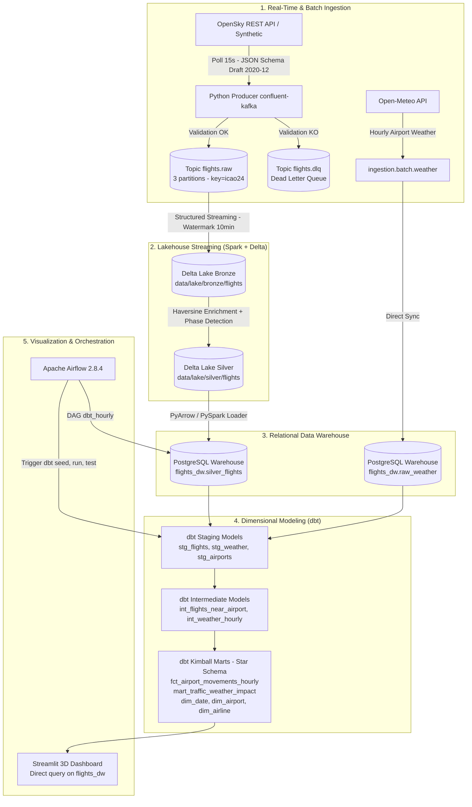

# 🇲🇦 Moroccan Air Traffic Streaming Platform

[](https://github.com/elhidaniassmaa/moroccan-air-traffic/actions)


[](LICENSE)

[🇫🇷 Passer à la version française](README.md)

An end-to-end real-time and analytical data engineering platform for monitoring Moroccan airspace (Casablanca CMN, Marrakech RAK, Rabat RBA, Agadir AGA, Tangier TNG).  
The system ingests live flight trajectories, normalizes them in a Delta Lake Lakehouse, loads them into a Kimball-modeled PostgreSQL Data Warehouse using dbt, and visualizes insights on an interactive 3D Streamlit dashboard.

---

## 📸 Platform Overview

| Streamlit 3D Dashboard (Live & Warehouse Data) | Kafka UI Cluster Overview |
| :---: | :---: |
|  |  |

| Apache Airflow Orchestration |
| :---: |
|  |

---

## 🎯 Business Context & Data Scope

The platform is **designed to analyze** how air traffic over Morocco interacts with:
- **Severe weather conditions** (high winds, gusts > 50 km/h, visibility < 2 km, precipitation) via the Open-Meteo API.
- **Calendar & religious cycles** (Ramadan, Eid al-Fitr, seasonal vacation shifts).
- **Major sports mega-events** (FIFA World Cup 2030).

> ℹ️ **Timeline Scope & Methodological Rigor:**  
> - **Active flight data:** Live collection started in **October 2026**. Available operational history reflects this observation window.
> - **Calendar indicators:** The date dimension (`dim_date`) is pre-computed with markers for key historical and upcoming events (Ramadan, Eid, World Cup 2030) to support trend analyses as data accumulates over time.
> - **Operational metrics:** Because the OpenSky Network API does not provide scheduled commercial timetables, the platform does not fabricate official delays. Instead, it computes **rigorous operational proxies**: hourly distinct aircraft density, geodesic flight phase heuristic classification (climb, cruise, descent, approach), and activity variance against historical medians.

---

## 🏛️ System Architecture



---

## 🛠️ Technology Stack

| Layer | Component | Operational Role |
| :--- | :--- | :--- |
| **Message Broker** | Apache Kafka 3.6 (Confluent 7.6.1) | Distributed persistent message stream, keyed by `icao24`. |
| **Cluster Coordination** | Apache ZooKeeper 3.8 | Consensus, controller election, and partition state. |
| **Stream Processing** | Apache Spark 3.5.1 (PySpark) | Structured Streaming with fault-tolerant temporal deduplication (`watermark 10 min`). |
| **Lakehouse Storage** | Delta Lake 3.1.0 | ACID table format for Bronze and Silver tiers on disk. |
| **Data Warehouse** | PostgreSQL 15 | Dedicated relational warehouse (`flights_dw`) hosting the analytical Gold tier. |
| **Data Transformation** | dbt (Data Build Tool) | Kimball star schema modeling, data contracts, and automated schema tests. |
| **Orchestration** | Apache Airflow 2.8.4 | Scheduling batch ingestion, warehouse synchronization, and dbt execution. |
| **BI & Visualization** | Streamlit + pydeck | Interactive 3D spatial flight tracking connected directly to `flights_dw`. |
| **Testing & Quality** | Pytest & Ruff | Unit/integration test suite, JSON Schema contract enforcement, PEP-8 compliance. |

---

## 🌐 Services & Web Endpoints

| Service | Local URL / Port | Credentials | Purpose |
| :--- | :--- | :--- | :--- |
| **Streamlit Dashboard** | [http://localhost:8501](http://localhost:8501) | *No auth* | 3D Pydeck flight map, hourly throughput, and weather correlation |
| **Kafka UI** | [http://localhost:8080](http://localhost:8080) | *No auth* | Monitoring topics (`flights.raw`, `flights.dlq`) and consumer lag |
| **Airflow Webserver** | [http://localhost:8085](http://localhost:8085) | `admin` / `admin` | DAG management (`dbt_hourly`, `weather_daily`) |
| **PostgreSQL DW** | `localhost:5433` | `flights_user` / `flights_password_dev` | Analytical database `flights_dw` (DBeaver / pgAdmin) |
| **Kafka Direct Broker** | `localhost:9092` / `localhost:19092` | *No auth (dev)* | Direct streaming access |

---

## 🚀 Quickstart Guide

### Prerequisites
- Docker and Docker Compose
- Python 3.11+

### 1. Environment Setup
```bash
cp .env.example .env
```
*(By default, `PRODUCER_SYNTHETIC_MODE=true` allows running the full pipeline without external credentials. Add your OpenSky credentials to `.env` and set `PRODUCER_SYNTHETIC_MODE=false` for live data).*

### 2. Start Infrastructure
```bash
docker compose up -d
```
Verify container health:
```bash
docker compose ps
```

### 3. Run Warehouse Sync & dbt Marts
```bash
# Sync Delta Lake Silver into PostgreSQL DW
docker compose exec airflow-webserver python -m ingestion.batch.silver_to_postgres

# Seed reference data, run models, and execute dbt data tests
docker compose exec airflow-webserver dbt seed --project-dir /opt/airflow/dbt_project --profiles-dir /opt/airflow/dbt_project
docker compose exec airflow-webserver dbt run --project-dir /opt/airflow/dbt_project --profiles-dir /opt/airflow/dbt_project
docker compose exec airflow-webserver dbt test --project-dir /opt/airflow/dbt_project --profiles-dir /opt/airflow/dbt_project
```

To verify dbt directly from Windows PowerShell (from the parent `Projet_2` directory), point it to the repository's project and profile. This avoids using an unrelated global `~/.dbt/profiles.yml`:
```powershell
$env:WAREHOUSE_HOST = "localhost"
$env:WAREHOUSE_PORT = "5433"
dbt debug --project-dir .\moroccan-air-traffic\dbt_project --profiles-dir .\moroccan-air-traffic\dbt_project
```

### 4. Run Test Suite
```bash
python -m pytest tests/
```

---

## 📐 Dimensional Modeling (dbt Kimball Star Schema)

The warehouse database `flights_dw` is divided into structured schemas:

```text
flights_dw
├── public (Raw tables loaded from Delta Lake & Open-Meteo)
│   ├── silver_flights
│   └── raw_weather
│
├── public_staging (Cleaned, strictly-typed numeric/timestamps, deduplicated)
│   ├── stg_flights
│   ├── stg_weather
│   ├── stg_airports (ICAO/IATA seed of Moroccan international hubs)
│   └── stg_airlines (Airline seed)
│
├── public_intermediate (Geodesic math and hourly aggregations)
│   ├── int_flights_near_airport (Haversine distance < 50 km)
│   ├── int_flight_phases (Climb, cruise, descent, approach heuristic classification)
│   └── int_weather_hourly (Normalized hourly weather metrics)
│
└── public_marts (Kimball Star Schema Fact & Dimension Tables)
    ├── dim_airport (Coordinates, ICAO/IATA codes, primary runways)
    ├── dim_date (Date dimension enriched with holiday & mega-event flags)
    ├── dim_airline (Airline dimension with SCD Type 2 snapshot)
    ├── fct_airport_movements_hourly (Hourly distinct movements by airport)
    ├── fct_traffic_density (Aircraft density by altitude bracket)
    └── mart_traffic_weather_impact (Final traffic vs weather severity mart)
```

### Multi-Target Portability (PostgreSQL & Snowflake)
> ℹ️ **Status:** Models are **designed to be portable, tested on PostgreSQL**.  
> A Snowflake profile is pre-configured in [`profiles.yml`](dbt_project/profiles.yml). Cross-dialect portability is achieved through ANSI-compliant date functions (`EXTRACT(DOW FROM ...)`, `TO_CHAR(...)`) and explicit `numeric` casting for floating-point calculations.

---

## 🔮 Roadmap & Future Enhancements

1. **Predictive Machine Learning**: Train an XGBoost model on `mart_traffic_weather_impact` to forecast airport congestion given weather forecasts.
2. **Prometheus & Grafana Observability**: Instrument Kafka consumer lag and Spark micro-batch latency.
3. **Apache Iceberg Table Format**: Evaluate Apache Iceberg integration alongside Delta Lake.

---

## 📄 License

This project is licensed under the MIT License - see the [LICENSE](LICENSE) file for details.
