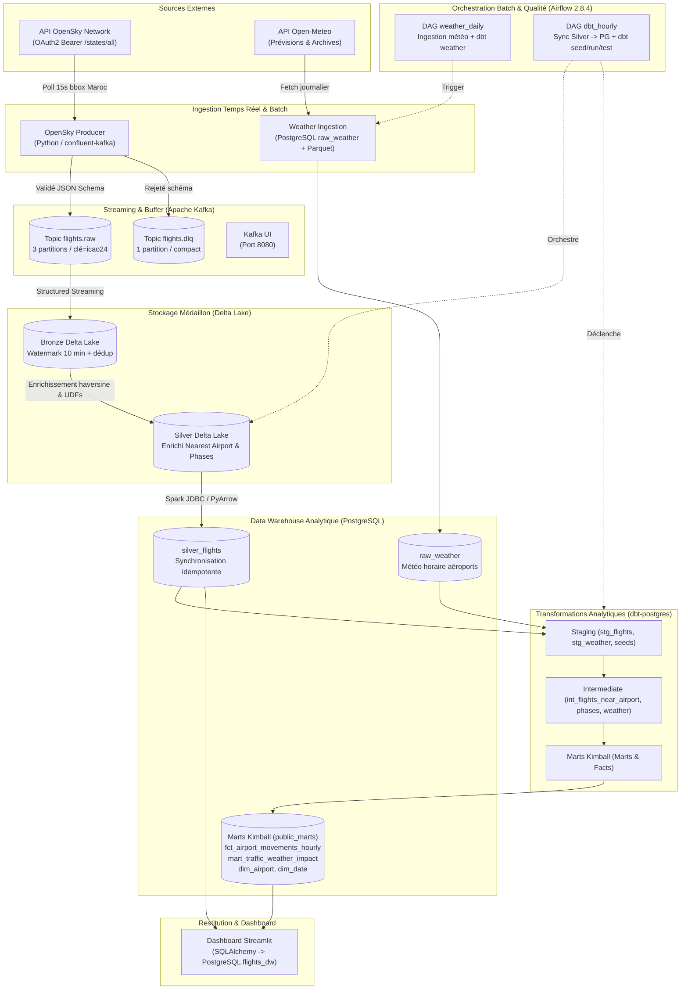

# Architecture Globale — Moroccan Air Traffic Platform

## 1. Vue d'ensemble du Système

La plateforme combine une ingestion continue d'événements aéronautiques (télémétrie ADS-B OpenSky Network) avec des enrichissements contextuels météorologiques et calendaires pour analyser la dynamique du trafic aérien marocain.

## 2. Choix Technologiques Industriels
1. **Apache Kafka (Confluent Platform 7.6.1)** : Standard d'entreprise pour le découplage et la haute disponibilité des flux de données.
2. **Spark Structured Streaming 3.5.1 + Delta Lake 3.1.0** : Traitement streaming exact-once avec transactions ACID et gestion du watermark.
3. **Data Warehouse PostgreSQL 15 (`flights_dw`)** : Entrepôt analytique relationnel dédié, isolé de la base de métadonnées d'Airflow, permettant des requêtes SQL performantes et standardisées.
4. **dbt (dbt-postgres / dbt-snowflake)** : Modélisation dimensionnelle Kimball avec tests automatisés de qualité (not_null, unique, accepted_values, relationships).
5. **Apache Airflow 2.8.4** : Orchestration robuste des pipelines de chargement et des cycles de transformation dbt.
6. **Streamlit** : Visualisation interactive connectée en direct à PostgreSQL via SQLAlchemy.
