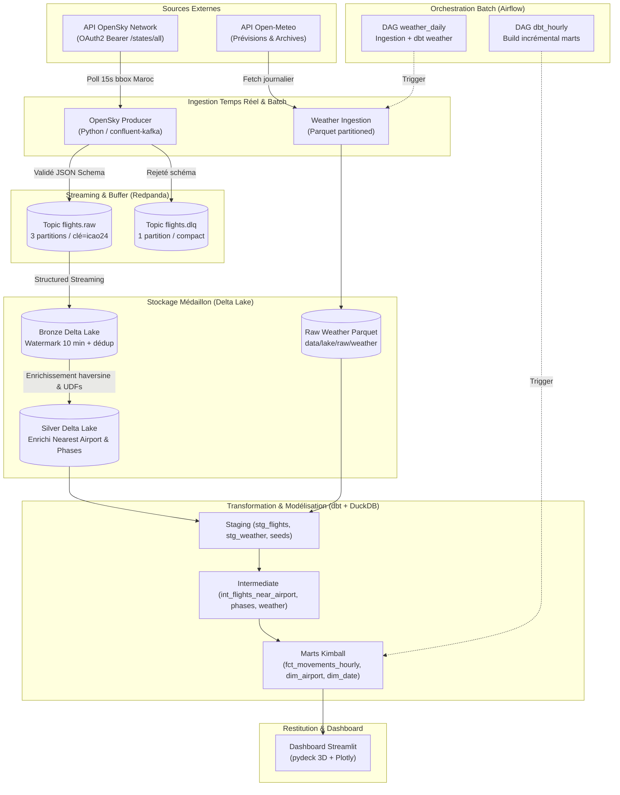

# Architecture Globale — Moroccan Air Traffic Platform

## 1. Vue d'ensemble du Système

La plateforme combine une ingestion continue d'événements aéronautiques (télémétrie ADS-B OpenSky Network) avec des enrichissements contextuels météorologiques et calendaires pour analyser la dynamique du trafic aérien marocain.

## 2. Principes & Décisions Techniques Clés

1. **Partitionnement Kafka par `icao24`** : Garantit que tous les états successifs d'un même aéronef arrivent dans la même partition, permettant la détection séquentielle d'états de vol sans reshuffle inter-partitions.
2. **Architecture Médaillon Delta Lake** :
   - **Bronze** : Stockage append-only des événements bruts validés, partitionné par `event_date`, avec déduplication sur `(icao24, time_position)` encadrée par un watermark de 10 minutes.
   - **Silver** : Calcul de proximité aux aéroports clés (CMN, RAK, RBA, AGA, TNG) via distance Haversine, classification heuristique des phases de vol (au sol, décollage, montée, croisière, approche, atterrissage).
3. **Modélisation Kimball avec dbt** :
   - Modèle incrémental `fct_airport_movements_hourly` avec stratégie `delete+insert` sur clé primaire surrogate MD5 `movement_hour_id`.
   - Snapshot SCD2 `snap_dim_airline` pour le suivi des évolutions de flotte ou compagnies.
4. **Découplage Strict Streaming vs Airflow** :
   - Airflow orchestre uniquement les jobs périodiques finis (météo, dbt hourly incrémental).
   - Les moteurs de streaming tournent en démons autonomes résilients.
